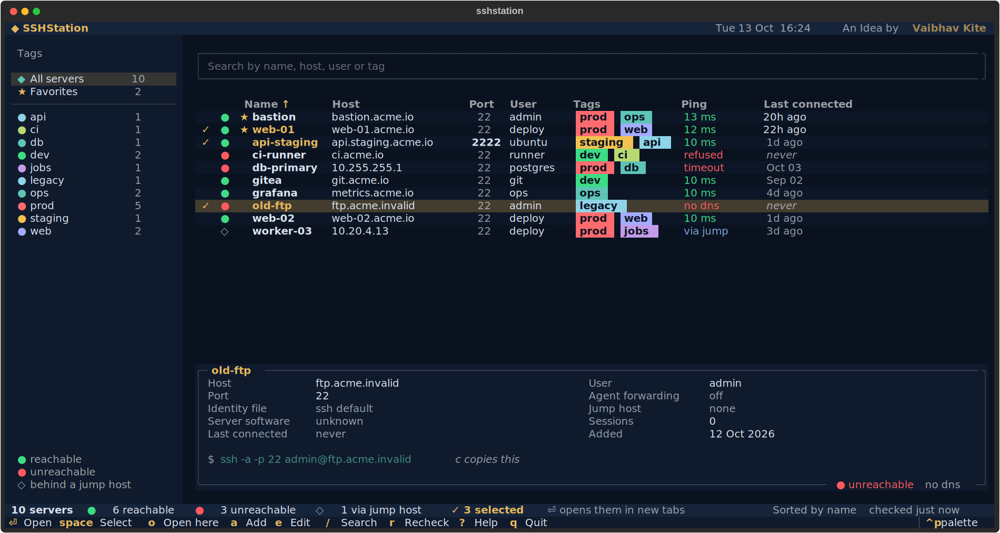

# SSHStation

A refined SSH server manager for the terminal, built with iTerm2 on macOS in mind.

**An Idea by Vaibhav Kite**



## Install

```bash
cd sshstation
./install.sh
```

This creates a private Python environment in `~/.local/share/sshstation` and puts an `sshstation` command in `~/.local/bin`. It needs Python 3.9 or newer; the `python3` that ships with macOS works, as does Homebrew's.

If you installed an earlier version (SSHMan, or before that hop), the installer removes the old command, and your servers are copied over the first time you run `sshstation`.

Prefer a shorter command? Run `./install.sh sst` (or any name you like). To remove SSHStation, run `./install.sh --uninstall`; your servers are kept. With pipx or uv, `pipx install .` or `uv tool install .` also work.

To look around before adding your own servers, run `sshstation --demo`. Nothing in demo mode is saved.

## Requirements

macOS with iTerm2 is the main target; tmux and other terminals work too, with Enter connecting in the same window when there's no way to open a tab. You need Python 3.9 or newer and the standard `ssh` client. The only Python dependency is [Textual](https://textual.textualize.io), which the installer sets up for you.

## Using it

Type `sshstation`. Each server shows its name, host, port, user, tags, ping and when you last connected. The lamp on the left shows whether it's reachable right now: green for reachable, red for unreachable (the Ping column says why: timeout, refused, no dns), and a hollow diamond for servers behind a jump host, which can't be checked directly. The bar at the bottom counts your servers and how many are up or down.

Press Enter to open the highlighted server in a new iTerm2 tab. SSHStation stays open in its own tab, so you can keep opening more. The tab closes when you log out; if ssh fails straight away, the tab waits so you can read the error.

To open several servers at once, press space on each one to select it (a ✓ appears and the cursor moves down), then press Enter. Every selected server opens in its own tab. `ctrl+a` selects everything currently shown, and `esc` clears the selection. If you select more than eight, SSHStation asks before opening them all.

| Key | Does |
| --- | --- |
| `⏎` | Open in a new tab: every selected server, or the highlighted one |
| `space` | Select or unselect the highlighted server |
| `ctrl+a` | Select all shown |
| `o` | Connect here, in this window; SSHStation returns when you log out |
| `c` | Copy the ssh command |
| `a` `e` `d` `x` | Add, edit, duplicate, delete |
| `f` | Add to or remove from favorites (favorites stay at the top) |
| `i` | Import hosts from `~/.ssh/config` |
| `ctrl+o` | Edit the servers file in your editor |
| `/` | Search by name, host, user or tag; `esc` clears it |
| `s` | Change sort order; clicking a column header works too |
| `r` | Check reachability again (it also rechecks every 2 minutes) |
| `j` `k` `g` `G` | Move down, up, to the first or to the last server |
| `ctrl+b` | Show or hide the tag list |
| `ctrl+p` | Command palette, including "Change theme" |
| `?` | All shortcuts |

Inside tmux, new tabs open as tmux windows instead. In a terminal with neither iTerm2 nor tmux, Enter connects in the same window.

## Adding a server

Press `a`. Name, host and port are the essentials; username, tags, identity file, jump host and extra ssh options (for example `-L 8080:localhost:80`) are optional. You can paste `deploy@10.0.1.5:2222` into the Host field and SSHStation fills in the user and port. Leave Name empty and it uses the host.

The agent forwarding switch adds `-A` when on and `-a` when off, so the setting holds even if your `~/.ssh/config` says otherwise. Forwarding lets the server use your local keys, so keep it for hosts you trust.

## The servers file

Everything is stored in one file, readable only by you:

```
~/.config/sshstation/servers.json
```

You can add or change servers there directly. Open it with `sshstation --edit`, with `ctrl+o` inside SSHStation, or in any editor. If SSHStation is running, your changes appear within a couple of seconds of saving.

Only `host` is required. To add a server, put an entry in the `servers` list:

```json
{
  "servers": [
    { "name": "web-01", "host": "10.0.1.15", "user": "deploy", "tags": ["prod", "web"] },
    { "name": "nas", "host": "192.168.1.20", "port": 2222, "user": "admin", "forward_agent": true },
    { "host": "10.0.0.7" }
  ]
}
```

| Field | Meaning | Default |
| --- | --- | --- |
| `host` | Host name or IP address (required) | |
| `name` | What the list shows | the host |
| `port` | SSH port | `22` |
| `user` | Login name | your ssh default |
| `tags` | A list like `["prod", "web"]`, or a string like `"prod, web"` | none |
| `forward_agent` | `true` adds `-A`, `false` adds `-a` | `false` |
| `identity_file` | Private key, e.g. `"~/.ssh/id_ed25519"` | your ssh default |
| `jump_host` | Reach the server through another, e.g. `"admin@bastion"` | none |
| `extra_args` | Anything else for ssh, e.g. `"-L 8080:localhost:80"` | none |
| `favorite` | `true` pins it to the top | `false` |

SSHStation fills in `id`, `created_at`, `last_connected` and `connect_count` itself; you can leave those out. It also accepts `hostname` for `host` and `username` for `user`, matching `~/.ssh/config` habits.

If you save the file with a mistake, such as a missing comma, SSHStation names the line and column and stops writing to the file until it's fixed, so nothing you typed is overwritten. An entry it can't use, such as one without a host, is skipped with a message saying which and why.

## From the command line

```bash
sshstation web-01          # connect straight away in this window (a unique prefix like `sshstation web-0` also works)
sshstation web             # several matches: opens the list, already filtered
sshstation --list          # print your servers
sshstation --list --check  # same, with reachability
sshstation --edit          # open the servers file in your editor
sshstation --config        # print where the servers file is
```

## iTerm2 extras

In each SSH tab, the tab title and badge show the server's name. Servers tagged `prod` turn the tab red, `staging` amber and `dev` green, so production is hard to mistake for anything else.

The first time you press Enter, macOS asks whether your terminal may control iTerm2. Allow it, or change it later in System Settings › Privacy & Security › Automation.

## Settings

The `settings` block at the bottom of `servers.json`:

| Setting | Default | Meaning |
| --- | --- | --- |
| `enter_opens_tab` | `true` | `false` makes Enter connect in the same window, as `o` does |
| `close_tab_on_exit` | `true` | `false` leaves the tab open at a local prompt after you log out |
| `refresh_interval` | `120` | Seconds between automatic checks; `0` means only when you press `r` |
| `probe_timeout` | `3.0` | Seconds before a server counts as unreachable |
| `iterm_tab_color` | `true` | Colour the tab for prod, staging and dev servers |
| `iterm_badge` | `true` | Show the server name as an iTerm2 badge during a session |
| `theme`, `sort`, `show_sidebar` | | Remembered from your last choice |

## How the reachability check works

SSHStation opens a TCP connection to each server's host and port, reads the SSH greeting, introduces itself and hangs up. It never tries to log in. Each check shows up in the server's sshd log as a short connection; if you run fail2ban or sshguard with strict rules, raise `refresh_interval` or set it to `0`.

## Credits

SSHStation is an idea by Vaibhav Kite. It's built on [Textual](https://textual.textualize.io) and [Rich](https://github.com/Textualize/rich).
